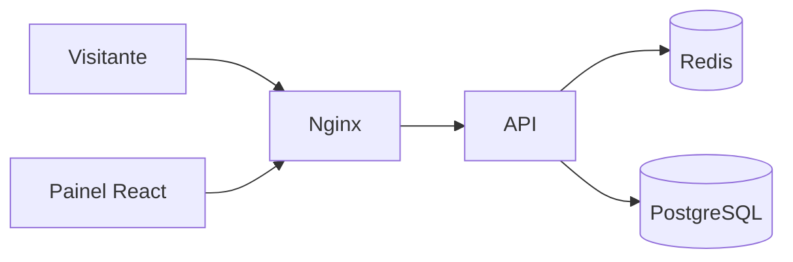

# Encurtador de URL

Uma aplicação para criar links curtos HTTPS sem login, com nomes personalizados, pastas e paths públicos. O projeto explora decisões de arquitetura para um serviço que precisa redirecionar rapidamente, preservar os dados operacionais e registrar acessos de forma simples.

> **Estado:** implementação inicial em evolução. O aceite de desempenho e a validação da publicação no Dokploy seguem pendentes.

## O que já existe

- Painel aberto para consultar e criar links, pastas e paths. A exclusão exige senha de administrador. A versão atual permite definir uma expiração futura na criação pela API e não oferece edição, pausa ou reativação.
- Nomes personalizados ou códigos gerados automaticamente; pastas para organização e paths públicos opcionais.
- Redirecionamento público encaminhado pelo Nginx à API, com Redis como primeira consulta e PostgreSQL como fonte persistente.
- Registro de acessos diretamente no PostgreSQL como JSON, com ocultação de headers de credenciais.

Relatórios, renomeação de pastas, alteração de endereços públicos, filtro de robôs e backups automatizados estão fora do escopo atual.

## Arquitetura



No backend, `backend/app/core.py` e `backend/app/domain.py` contêm as regras e os tipos do domínio. `backend/app/application/` concentra as operações e define as interfaces usadas para consultar e persistir dados. `backend/app/web.py` adapta HTTP para essas operações, `backend/app/infrastructure/` implementa o acesso ao PostgreSQL e ao Redis, e `backend/app/main.py` conecta as camadas. No frontend, `frontend/src/App.jsx` reúne os componentes e `frontend/src/api.js` concentra as chamadas HTTP.

O PostgreSQL armazena links, pastas e paths compartilhados. O código curto e o destino são únicos globalmente. Uma sequência separada alimenta o gerador automático Feistel de 40 bits com BLAKE2b e Base62. Nomes escolhidos pelo usuário compartilham o mesmo espaço de códigos. A pasta organiza os links e o path faz parte da URL pública. Os registros são compartilhados entre todos os visitantes.

Links são excluídos logicamente: código e destino continuam reservados para impedir que uma URL antiga passe a apontar para outro cadastro. Pastas e paths associados a links não podem ser removidos. A aplicação registra uma impressão digital dos parâmetros do gerador e recusa alterações incompatíveis; mudar chave, alfabeto ou algoritmo exige planejar uma migração.

A API tenta registrar cada `GET` e `HEAD` processado pela rota curta, inclusive respostas `404` e `410`. Os eventos ficam em `access_events.payload` (JSONB), com os valores dos headers de credenciais ocultados. A tabela é criada na inicialização se ainda não existir.

A gravação é síncrona e usa um conjunto separado de até quatro conexões com o PostgreSQL, com espera de até 20 ms por uma conexão livre e limite de 100 ms por instrução no servidor. Se a escrita falhar, a API registra um aviso sem o conteúdo do evento e segue com a resposta. A cada 30 segundos, a API remove até 10.000 registros que ficaram fora da janela dos `ANALYTICS_MAX_EVENTS` IDs mais recentes (100.000 por padrão). A meta de desempenho precisa ser medida com a escrita e a limpeza ativas.

## Cache e consistência

Um acerto no Redis resolve o destino sem consultar o PostgreSQL. O registro do acesso ainda grava no banco. A API consulta o banco quando falta uma entrada válida ou o Redis está indisponível. O cadastro não aquece o cache. O TTL padrão é de 30 minutos e o prazo do cache respeita a expiração do link. A API também verifica a expiração na leitura e usa `Cache-Control: no-store` nas respostas da rota curta.

Antes de excluir um link, a API coordena a operação por código, remove a entrada e o marcador de preenchimento do Redis e só então altera o PostgreSQL. Se a invalidação falhar, a exclusão é recusada. O preenchimento do cache usa o mesmo bloqueio transacional e confere o marcador no Redis antes de publicar a entrada. O marcador expira em 5 segundos por padrão e é removido quando a publicação tem sucesso. A invalidação revoga o marcador. O Redis do Compose reinicia com o cache vazio e descarta chaves menos usadas ao atingir o limite configurado, de 64 MB por padrão.

Se a gravação no banco falhar, a API tenta invalidar novamente. Caso a conexão falhe durante a confirmação da transação, a mensagem orienta atualizar a página e verificar o estado antes de repetir. A simulação local de perda da conexão antes e depois do `COMMIT` confirmou respostas `503` sem deixar uma entrada desatualizada no cache. O protocolo usa um único Redis descartável.

## Executar

A publicação prevista usa Docker Compose e Dokploy, com HTTPS configurado no proxy. Apenas o Nginx (`frontend`) participa da rede externa existente `dokploy-network`. A API, o PostgreSQL e o Redis ficam na rede privada do projeto. A rede externa precisa existir antes de iniciar o Compose.

1. Copie `.env.example` para `.env`. Configure os domínios HTTPS e inclua os dois hosts em `ALLOWED_HOSTS`. O health check da API usa o host de `SHORT_BASE_URL`.
2. Gere valores diferentes para `SHORT_CODE_KEY` e `API_KEY` com `python3 -c "import secrets; print(secrets.token_hex(32))"`. Configure `ADMIN_PASSWORD` com 16 a 128 caracteres ASCII visíveis e difíceis de adivinhar. Use a mesma senha em `POSTGRES_PASSWORD` e `DATABASE_URL`, aplicando codificação percentual na URL se a senha tiver caracteres reservados. A chave API fica no ambiente do Nginx e da API.
3. Configure `TRUSTED_PROXY_CIDR` com o endereço ou CIDR dedicado do Traefik na rede Docker. Use `/32` para um endereço IPv4 fixo. O Nginx usa o `X-Forwarded-For` apenas de um proxy confiável. Se o endereço do Traefik mudar, atualize essa configuração.
4. Execute `docker compose up --build -d`. No Dokploy, direcione os dois domínios para o serviço `frontend`: o painel na porta 80 e o domínio curto na porta 8080. Configure TLS nos dois domínios. Em uma instalação que encaminhava o domínio curto a `api:8000`, atualize o destino no Dokploy ao aplicar esta configuração.

O painel é aberto e seu conteúdo é compartilhado. Cada exclusão exige a senha de administrador. Na porta do painel, o Nginx substitui a chave API fornecida pelo cliente pela chave interna. Na porta do domínio curto, a API valida a chave fornecida pelo cliente nas rotas `/api/`. O painel limita `/api/` a 30 requisições por minuto por IP, com rajada de 20. Exclusões têm limite adicional de 5 por minuto, com rajada de 2. No domínio curto o limite é de 20 por segundo por IP, com rajada de 50. As duas portas têm cotas globais independentes. O painel admite 20 por segundo, com rajada de 60. O domínio curto admite 100 por segundo, com rajada de 100. O Nginx usa dois buffers grandes de 4 KiB para os cabeçalhos. Se houver CDN na frente do Traefik, valide a cadeia de confiança para que o limite considere o IP do visitante.

A versão anterior usava tabelas ligadas a usuários Google. A API identifica esse esquema pela coluna `links.owner_id` e interrompe a inicialização antes de modificá-lo. Migre os dados antes de reutilizá-los ou use um banco novo para testes.

Na inicialização, a API cria tabelas ausentes. Mudanças em tabelas existentes exigem migração separada. O volume `postgres_data` preserva os dados do PostgreSQL.

## Testes e validação

```sh
python3 -m pip install -r backend/requirements-dev.txt
PYTHONPATH=backend python3 -m unittest discover -s backend/tests -v
cd frontend && npm ci && npm run build
```

A suíte automatizada cobre validação de URLs e nomes, geração de códigos, autorização, sanitização dos eventos e cenários simulados de cache. Em containers isolados com PostgreSQL, Redis e Nginx, a revisão também verificou conflitos concorrentes no cadastro, expiração, invalidação e recuperação após reiniciar o Redis.

O aceite ainda exige validar a implantação e medir a meta de menos de 100 ms com 50 acessos simultâneos no ambiente Dokploy.

A [especificação](docs/SPEC.md) reúne as regras detalhadas, decisões e pendências do projeto.
